# Arcade Machine Floor Layout & 3D Walkthrough Desktop Application
## Architecture & Implementation Plan
 
---

### Executive Overview

The goal is to build a high-performance desktop application that enables arcade operators, enthusiasts, and venue planners to design custom floor plans to scale, arrange arcade machines with exact physical dimensions, and transition seamlessly between a **2D top-down CAD-style layout editor** and an **immersive 3D walkthrough/flythrough experience**.

---

## 1. Technology Stack Recommendation

| Component | Recommended Technology | Rationale |
| :--- | :--- | :--- |
| **Desktop Shell** | **Tauri v2** (or Electron) + **Vite** | Lightweight native bundle size (<15 MB vs 150 MB+), native file system access for auto-save, high-performance WebGL rendering with low memory overhead. |
| **Frontend Framework** | **React + TypeScript** | Type-safe state management, rich component ecosystem for CAD toolbars, modals, and property inspectors. |
| **Rendering Engine** | **Three.js** (`@react-three/fiber` + `@react-three/drei`) | Unified canvas for both **2D orthographic top-down** and **3D perspective views**, eliminating state desynchronization. |
| **State Management** | **Zustand** + `zundo` | High-performance reactive state, seamless persistence middleware, built-in undo/redo history stack for layout manipulation. |
| **Controls & Navigation** | Three.js `PointerLockControls` & `FlyControls` | First-person FPS-style walkthrough (WASD + mouse look) and free-flight aerial exploration. |
| **Data Storage / Auto-Save** | Local JSON File System + `IndexedDB` fallback | Instant session persistence across restarts, zero cloud dependency, exportable/importable `.arcade` project files. |

---

## 2. Core Functional Requirements Breakdown

```mermaid
graph TD
    A[Arcade Floor Planner] --> B[2D Top-Down CAD View]
    A --> C[3D Walkthrough / Flythrough View]
    A --> D[Measurement & Unit System]
    A --> E[Machine Catalog & Template Manager]
    A --> F[Auto-Save & Project Persistence]

    B --> B1[Room Drawing Tool]
    B --> B2[Grid Snapping & Dimensions]
    B --> B3[Machine Placement & Drag/Rotate]
    B --> B4[Copy / Paste / Clone]

    C --> C1[Orbit / Isometric Inspector]
    C --> C2[First-Person Walkthrough WASD]
    C --> C3[Free-Flight Flythrough]
    C --> C4[Neon & Marquee Lighting]

    D --> D1[Imperial: Inches & Feet]
    D --> D2[Metric: Centimeters & Meters]
    D --> D3[Real-Time Dimension Overlays]

    E --> E1[Standard Upright / Pinball / Cockpit / 4-Player]
    E --> E2[Custom Machine Dimensions WxDxH]
    E --> E3[Player Clearance Zones]

    F --> F1[Debounced Auto-Save Engine]
    F --> F2[Session State Restoration]
    F --> F3[Export / Import .arcade Files]
```



---

## 3. Detailed Subsystem Specifications

### 3.1 Unit Conversion & Canonical Dimension Engine
To avoid floating-point conversion errors when switching units, all coordinates and dimensions are stored internally in **millimeters (`mm`)**:

- **Internal Canonical Storage**: `1 unit = 1 mm` (or standard integer/high-precision float).
- **Unit Display Modes**:
  1. **Imperial**:
     - *Inches Mode*: e.g., `25.5" W × 33.0" D × 68.0" H`
     - *Feet & Inches Mode*: e.g., `2' 1.5" W × 2' 9" D × 5' 8" H`
  2. **Metric**:
     - *Centimeters Mode*: e.g., `65 cm W × 84 cm D × 173 cm H`
     - *Meters Mode*: e.g., `0.65 m W × 0.84 m D × 1.73 m H`
- **Dynamic Unit Formatting**: Changing unit preference instantly recalculates all UI input boxes, dimension labels, grid intervals, and scale indicators without altering spatial coordinates.

---

### 3.2 Floor Area Drawing System (2D CAD Mode)
The user defines the venue geometry before or during machine placement:

1. **Drawing Modes**:
   - **Rectangular Room Builder**: Click-and-drag or input exact Width × Length.
   - **Custom Polygon / Wall Builder**: Click-to-place wall vertices with automatic angle snapping (0°, 45°, 90° via `Shift` key).
   - **Predefined Venue Shapes**: L-shaped, T-shaped, or multi-room layouts.
2. **CAD Assistance Tools**:
   - Dynamic grid overlay with configurable spacing (e.g., 1 ft / 0.5 m intervals).
   - Real-time dimension callouts along wall edges showing exact measurements.
   - Scale bar on the bottom status bar reflecting current zoom level.
   - Pan and zoom with middle-mouse drag or wheel scroll.

---

### 3.3 Arcade Machine Catalog & Clearance System
Predefined machine templates with realistic physical dimensions and clearance boundaries:

| Machine Category | Default Dimensions (W × D × H) | Player Clearance (Front) | Service Clearance (Rear) |
| :--- | :--- | :--- | :--- |
| **Standard Upright** (e.g., Pac-Man, Galaga) | 25" × 33" × 68" (64 × 84 × 173 cm) | 30" (76 cm) | 6" (15 cm) |
| **Deluxe / Widebody** (e.g., Street Fighter) | 30" × 40" × 72" (76 × 102 × 183 cm) | 36" (91 cm) | 6" (15 cm) |
| **4-Player Cabinet** (e.g., TMNT, NBA Jam) | 42" × 48" × 75" (107 × 122 × 191 cm) | 48" (122 cm) | 8" (20 cm) |
| **Pinball Machine** (Standard Body) | 29" × 52" × 76" (74 × 132 × 193 cm) | 36" (91 cm) | 4" (10 cm) |
| **Cocktail / Tabletop** | 32" × 22" × 29" (81 × 56 × 74 cm) | 24" both sides (61 cm) | None |
| **Driving / Racing Cockpit** | 30" × 60" × 72" (76 × 152 × 183 cm) | 24" entry (61 cm) | 12" (30 cm) |
| **Dance Platform / Rhythm** (DDR) | 70" × 90" × 88" (178 × 229 × 224 cm) | 48" (122 cm) | 12" (30 cm) |
| **Skee-Ball / Alley Roller** | 30" × 120" × 84" (76 × 305 × 213 cm) | 48" (122 cm) | 6" (15 cm) |
| **Custom Machine** | User-defined Width, Depth, Height | User-defined | User-defined |

#### Clearance Zone & Collision Detection
- Each machine displays a primary physical footprint (solid color) and an optional dashed **Player Clearance Zone** in front of the controls.
- Visual warning highlights (red outline) if two machines overlap or if a clearance zone is blocked by a wall or another cabinet.

---

### 3.4 Interactive Layout & Editing Controls

- **Placement**: Drag machine template from catalog onto the 2D floor plan.
- **Selection**: Click machine to select; multi-select with `Shift + Click` or rubberband box select.
- **Translation / Movement**:
  - Drag with mouse with intelligent edge-snapping to adjacent machines or walls.
  - Arrow keys for micro-nudges (e.g., 1" or 1 cm increments; `Shift + Arrow` for 6" or 10 cm).
- **Rotation**:
  - Rotation gizmo in 2D, or shortcut `R` / `Shift + R` (rotates in 90°, 45°, or 15° increments).
- **Cloning & Clipboard**:
  - **Duplicate**: `Cmd/Ctrl + D` or `Alt + Drag` immediately clones the selected machine with a small offset.
  - **Copy / Paste**: `Cmd/Ctrl + C` and `Cmd/Ctrl + V` copies machine properties and places new instance at cursor position.
- **Delete / Undo**: `Backspace` / `Del` to remove; `Cmd/Ctrl + Z` and `Cmd/Ctrl + Shift + Z` for complete history traversal.

---

### 3.5 2D vs. 3D Modes & Camera Systems

The application provides a single toggle switch or keyboard shortcut (`Space` or `Tab`) to switch perspectives:

#### 1. 2D Top-Down Mode (Orthographic)
- Orthographic camera looking directly down (`Y = +Height, LookAt = (X, 0, Z)`).
- Crisp vector-like display: machine labels, direction facing indicator (front bezel arrow), dimension callouts, snap grid.

#### 2. 3D Orbit / Overview Mode (Perspective)
- Isometric / angled perspective camera with orbit controls (`Left Click` rotate, `Right Click` pan, `Scroll` zoom).
- Visualizes 3D cabinets with realistic proportions, angled marquees, coin doors, and control panel slopes.

#### 3. 3D Walkthrough Mode (First-Person)
- Eye-level perspective camera positioned at standard human height (~5 ft 6 in / 1.7 m).
- Controls:
  - **Mouse Movement**: Pointer-lock look around (pitch and yaw).
  - **Keyboard**: `W`, `A`, `S`, `D` to walk forward, backward, strafe left, and strafe right.
  - **Collision Prevention**: Prevents walking through walls and machines.

#### 4. 3D Flythrough Mode (Spectator / Drone)
- Unconstrained 6-DOF camera.
- `W`, `S` move forward/back, `A`, `D` strafe, `E` fly upward, `Q` descend.
- Ideal for viewing room layout from high angles or recording flythrough tours.

#### 5. Atmospheric Arcade Visuals
- **Lighting**: Dim ambient room lighting accented with ceiling track lights.
- **Emissive Elements**: Glowing arcade marquee signs, vibrant CRT/LCD screen glow, blinking coin reject buttons.
- **Floor Textures**: Preset options for 90s neon galaxy arcade carpet, polished industrial concrete, and dark wood flooring.

---

### 3.6 Data Schema & Auto-Save Persistence

#### Project Data Model (`arcade_project.json`)
```typescript
interface ArcadeProject {
  version: string;
  id: string;
  name: string;
  updatedAt: string;
  settings: {
    unitSystem: "imperial" | "metric";
    unitDisplay: "inches" | "feet-inches" | "cm" | "meters";
    gridSizeMm: number;
    snapToGrid: boolean;
    snapToObjects: boolean;
    showClearanceZones: boolean;
    wallHeightMm: number;
  };
  floorPlan: {
    walls: Array<{
      id: string;
      start: { x: number; y: number }; // mm in 2D plane
      end: { x: number; y: number };
      thicknessMm: number;
    }>;
    material: "neon-carpet" | "polished-concrete" | "wood" | "grid";
  };
  customCatalog: Array<MachineDefinition>;
  placedMachines: Array<{
    instanceId: string;
    definitionId: string;
    name: string;
    position: { x: number; y: number; z: number }; // mm
    rotationYDeg: number;
    customDimensions?: { widthMm: number; depthMm: number; heightMm: number };
    cabinetColor?: string;
    marqueeTitle?: string;
  }>;
}
```

#### Auto-Save Strategy
1. **Debounced Auto-Save**: Any modification triggers a debounced (500 ms) save operation to local disk.
2. **Session State Cache**: Camera position, active mode (2D or 3D), and UI panel toggles are saved so reopening the app resumes exactly where the user left off.
3. **Rolling Revision Backups**: Maintains the 3 most recent revisions to safeguard against unexpected system crashes or power losses.
4. **Export / Import**: Manual `File -> Export Project (.arcade)` and `File -> Import Project` for archiving and sharing floor plans.

---

## 4. User Interface Layout & Wireframe

```
+--------------------------------------------------------------------------------------------------+
|  [Logo] Arcade Planner   | Mode: [2D CAD] [3D Orbit] [3D Walk] | Unit: [Inches/Ft | cm/m]  [Auto-Saved] |
+--------------------------+-------------------------------------------------------+---------------+
| TOOLBAR: [Draw Wall] [Select] [Delete] [Undo] [Redo] | [Grid: On] [Snap: On] [Clearance: On]      |
+--------------------------+-------------------------------------------------------+---------------+
| MACHINE CATALOG          |                                                       | PROPERTIES    |
| [Search Machines...]     |                                                       | [Selection]   |
|                          |                   MAIN VIEWPORT                       | Galaga Upright|
| Preset Machines:         |                                                       |               |
| > Standard Upright       |             (2D Interactive Grid Floor                | Width:  25.0" |
| > Deluxe / Widebody      |                         OR                            | Depth:  33.0" |
| > 4-Player Cabinet       |               3D Walkthrough Scene)                   | Height: 68.0" |
| > Pinball Machine        |                                                       |               |
| > Cocktail Table         |                                                       | Rotation: 90° |
| > Driving Cockpit        |                                                       | Pos: X: 12' Y: 8'|
| > Dance Platform (DDR)   |                                                       |               |
| > Skee-Ball              |                                                       | [Duplicate]   |
|                          |                                                       | [Delete]      |
| [+ New Custom Machine]   |                                                       | [Clone 5x...] |
+--------------------------+-------------------------------------------------------+---------------+
| Status: Floor Area: 1,450 sq ft (134.7 m²) | Placed Machines: 18 | Cursor: X: 14' 2", Y: 9' 6"   |
+--------------------------------------------------------------------------------------------------+
```

---

## 5. Phase-by-Phase Implementation Roadmap

### Phase 1: Project Scaffolding & Core Architecture
- Set up desktop shell (Tauri/Electron + React + TypeScript + Vite).
- Implement mathematical coordinate and unit conversion engine (mm canonical base with dual Imperial/Metric display).
- Build the Zustand store with undo/redo and local persistence engine.

### Phase 2: 2D Floor Plan Canvas & Grid Drawing
- Create 2D Orthographic canvas with pan/zoom.
- Build grid renderer with scale indicators.
- Implement room builder: Rectangular room tool and multi-vertex wall drawing tool with dimension tags.

### Phase 3: Machine Catalog, Placement & Interaction
- Build machine catalog sidebar with predefined templates and custom machine dialog.
- Implement drag-and-drop placement, selection, move gizmo, and collision detection.
- Implement keyboard shortcuts: duplicate (`Cmd+D`), copy/paste (`Cmd+C`/`Cmd+V`), rotate (`R`), and delete (`Del`).
- Implement visual clearance box toggles.

### Phase 4: 3D Scene Generation & Cabinet Models
- Generate procedural 3D room walls and floor based on 2D room geometry.
- Construct parametric 3D arcade cabinet meshes (cabinet side art profiles, angled marquee, recessed monitor bezel, coin door).
- Add materials, textures, and lighting (neon ambiance, glowing marquees, CRT glow).

### Phase 5: 3D Walkthrough & Flythrough Camera Controls
- Implement first-person camera with `PointerLockControls` (WASD + mouse look).
- Implement camera wall & cabinet collision so user stays on the floor.
- Implement free-flight spectator mode (FlyControls).
- Smooth animated camera transition between 2D Top-Down and 3D positions.

### Phase 6: Persistence, Auto-Save & Export
- Implement debounced auto-save to local disk.
- Implement project export and import (`.arcade` JSON files).
- Add session recovery (resuming active mode, selected unit, and camera viewpoint).

### Phase 7: UI Polish, Aesthetics & Testing
- Apply dark glassmorphic arcade styling with modern typography.
- Add machine count, power load estimate, and total floor coverage statistics.
- Verify seamless performance with 50+ machines on screen.

---

> [!TIP]
> **Next Step**: Once you review and approve this plan, we can proceed to initialize the project structure and build the application step-by-step.
